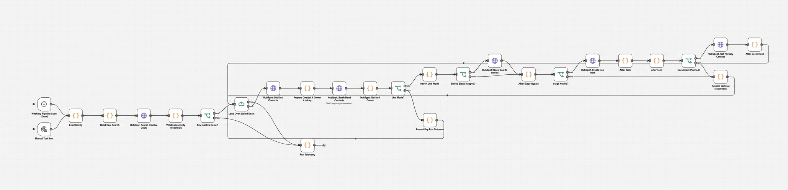
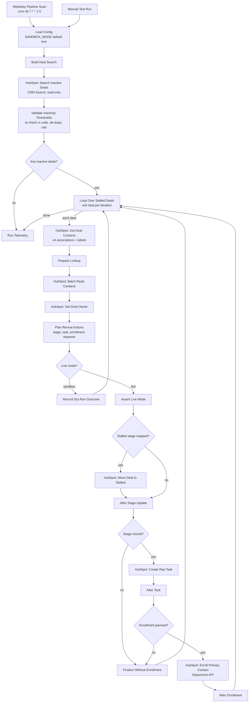

# n8n HubSpot Inactive Deal Revival Engine

[](LICENSE)
[](https://github.com/dhrobinsystems/n8n-hubspot-inactive-deal-revival-engine/actions/workflows/ci.yml)
[](https://n8n.io)
[](package.json)

**Stop letting deals die quietly.** Every weekday morning, this n8n workflow finds open HubSpot deals with **no logged calls, sales emails or meetings in the last 30 days**. For each one, it:

1. **Moves the deal to your "Stalled" stage**, recording the previous stage so it can be restored.
2. **Creates a follow-up task** for the deal owner, or a fallback owner when the deal is unowned.
3. **Enrolls the primary contact** in a low-touch re-engagement **sequence**, sent from the owner's connected inbox.

A full run report (dry-run or live) is written to the n8n execution log.

Built and maintained by **DH Robin** ([dhRobin Systems](https://dhrobinsystems.com), `dhrobinsystems`).

---

## Table of contents

- [Architecture](#architecture)
- [How "inactive" is decided](#how-inactive-is-decided)
- [Node configuration guide](#node-configuration-guide)
- [Safety rails](#safety-rails)
- [Environment variables](#environment-variables)
- [Deployment](#deployment)
- [Dry-run telemetry](#dry-run-telemetry)
- [Developer workflow](#developer-workflow)
- [Disclaimer](#️-disclaimer--liability-limitation)
- [License](#license)

---


## Pipeline Architecture

The workflow automates deal inactivity triage, stage updates, task creation, and contact re-engagement as visualized below:





**Design principles**

- **All logic lives in [`src/inactiveDealEngine.js`](src/inactiveDealEngine.js)** and [`src/config.js`](src/config.js). It is pure and dependency-free, and `npm run build` compiles it into the n8n Code nodes, so the workflow and the tested code can't drift apart (CI enforces this).
- **Order of writes per deal:** stage first, then task, then enrollment. If the stage update fails, no task or enrollment is created for that deal.
- **Explicit state hand-off:** every step after a write passes an outcome record forward. A node skipped in one loop iteration can never leak results from a previous deal.
- **Self-paging backlog:** stalled deals drop out of the search, so the next run continues with the next batch (`MAX_DEALS_PER_RUN`).

---

## How "inactive" is decided

| Rule | Detail |
| --- | --- |
| Engagement signal | `ACTIVITY_PROPERTY`, default **`notes_last_contacted`** (HubSpot "Last Contacted": the last logged call, sales email, meeting or chat). Use `notes_last_updated` ("Last Activity Date") if you also want notes and tasks to count as activity. |
| Threshold | Inactive when `now - lastContacted > INACTIVITY_DAYS × 24h` (**strictly greater**). Exactly 30 days is still active. |
| Never contacted | Falls back to `createdate`, so a 40-day-old deal that was never contacted is inactive. |
| Open deals only | Search filter `hs_is_closed = false`, re-checked in code. |
| Scope | Only pipelines in `PIPELINE_IDS`. Deals already in the Stalled stage, or in `EXCLUDED_STAGE_IDS`, are skipped. |
| Guards | `MIN_DEAL_AGE_DAYS` (default 30) protects brand-new deals. `MIN_DEAL_AMOUNT` optionally limits the engine to valuable deals. |
| Defence in depth | The CRM Search narrows the list, then every deal is **re-validated in code**. Search indexes can lag, and code-level checks catch clock or timezone mistakes and duplicate rows. |

**Primary contact selection:** contacts are ranked by deal association label (`PRIMARY_CONTACT_LABELS`, for example *Primary*, *Decision Maker*, *Champion*), falling back to the first associated contact. A contact is never enrolled when it has no valid email, **has opted out of email** (`hs_email_optout`), or is **already in a sequence** (`hs_sequences_is_enrolled`).

**Owner fallbacks:**

| Situation | Task assignee | Sequence enrollment |
| --- | --- | --- |
| Active deal owner | deal owner | sent from the owner's connected inbox |
| No owner, or owner archived | `FALLBACK_OWNER_ID` | **skipped** (`no_active_deal_owner_to_send_from`) |
| No owner and no fallback | unassigned (warning) | skipped |
| Owner without HubSpot user / email | deal owner | skipped (`owner_missing_user_id_or_email`) |

---

## Node configuration guide

| Node | Configuration |
| --- | --- |
| **Weekday Pipeline Scan (Cron)** | `40 7 * * 1-5` in the n8n instance timezone (`GENERIC_TIMEZONE`). |
| **Load Config** | No settings. Reads the environment variables below and fails fast with a full list of problems. |
| **HubSpot: Search Inactive Deals** | `POST /crm/v3/objects/deals/search` with two filter groups (contacted before the cutoff, or never contacted and created before it), sorted oldest activity first. |
| **Validate Inactivity Thresholds** | Re-validates, de-duplicates and caps the batch. Throws (failing the execution) if the search itself failed, so a broken token is never mistaken for an empty pipeline. |
| **HubSpot: Get Deal Contacts** | `GET /crm/v4/objects/deals/{id}/associations/contacts` (returns association labels). |
| **HubSpot: Batch Read Contacts** | `POST /crm/v3/objects/contacts/batch/read` with `email`, `firstname`, `hs_email_optout`, `hs_sequences_is_enrolled`. |
| **HubSpot: Get Deal Owner** | `GET /crm/v3/owners/{ownerId}`. Provides the `userId` and email the Sequences API needs. |
| **HubSpot: Move Deal to Stalled** | `PATCH /crm/v3/objects/deals/{id}` → `dealstage` (+ optional `PREVIOUS_STAGE_PROPERTY`, `STALLED_AT_PROPERTY`). |
| **HubSpot: Create Rep Task** | `POST /crm/v3/objects/tasks`: subject from `TASK_SUBJECT_TEMPLATE`, due in `TASK_DUE_IN_DAYS`, priority `TASK_PRIORITY`, associated to the deal (type 216) and the primary contact (type 204). |
| **HubSpot: Enroll Primary Contact** | `POST /automation/v4/sequences/enrollments?userId=<owner userId>` with `sequenceId`, `contactId`, `senderEmail`. |
| **Run Telemetry** | Final report in the execution log. |

All HubSpot nodes are HTTP Request nodes using the **HubSpot App Token** credential type, because the built-in HubSpot node doesn't cover CRM Search filter groups or the Sequences API.

---

## Safety rails

- **`SANDBOX_MODE=true` by default:** search and plan only. Typos keep sandbox on.
- **Fail-safe gate:** only `mode === "live"` reaches the write nodes, `Assert Live Mode` re-reads the environment, and `npm run check` statically proves that no write node is reachable in sandbox.
- **No silent failures:** the search failing stops the run. Per-deal write failures are recorded and reported, never treated as success.
- **Compliance:** opted-out and already-enrolled contacts are never enrolled. Sequences send from the rep's own connected inbox.
- **Privacy:** telemetry contains deal IDs, statuses and **masked** emails only. Samples use fictional data on reserved `example.*` domains. Credentials ship as `REPLACE_WITH_YOUR_CREDENTIAL_ID`, and the workflow ships **inactive**.

---

## Environment variables

| Variable | Default | Description |
| --- | --- | --- |
| `SANDBOX_MODE` | `true` | Plan and report only. |
| `INACTIVITY_DAYS` | `30` | Inactivity threshold (strictly greater). |
| `ACTIVITY_PROPERTY` | `notes_last_contacted` | Engagement timestamp property. |
| `MIN_DEAL_AGE_DAYS` | `30` | Skip younger deals. |
| `MIN_DEAL_AMOUNT` | `0` | Optional value floor. |
| `MAX_DEALS_PER_RUN` | `50` | 1-200 deals per run. |
| `PIPELINE_IDS` | `default` | Pipelines to scan. |
| `STALLED_STAGE_BY_PIPELINE` | *(empty)* | JSON `{"<pipelineId>":"<stalledStageId>"}`. Required live. |
| `EXCLUDED_STAGE_IDS` | *(empty)* | Stages never touched. |
| `PREVIOUS_STAGE_PROPERTY` / `STALLED_AT_PROPERTY` | *(empty)* | Optional custom deal properties for restore info. |
| `FALLBACK_OWNER_ID` | *(empty)* | Task owner for unowned deals. |
| `TASK_DUE_IN_DAYS` / `TASK_PRIORITY` / `TASK_SUBJECT_TEMPLATE` | `2` / `HIGH` / see template | Task settings. |
| `ENROLL_IN_SEQUENCE` | `true` | Toggle enrollment. |
| `SEQUENCE_ID` | *(empty)* | Re-engagement sequence ID. Required live when enrollment is on. |
| `PRIMARY_CONTACT_LABELS` | `Primary,Decision Maker,Champion` | Association label priority. |

---

## Deployment

1. **HubSpot preparation**
   - Create a **Stalled** stage in each monitored pipeline and note the stage IDs (Settings → Objects → Deals → Pipelines).
   - Build a low-touch re-engagement **sequence** and note its ID. Sequences need a paid Sales Hub or Service Hub seat, and every rep must have a **connected inbox**.
   - Optional: create the deal properties for `PREVIOUS_STAGE_PROPERTY` (single-line text) and `STALLED_AT_PROPERTY` (date picker).
   - Create a **private app** with these scopes: deals read/write, contacts read, owners read, tasks write (if listed separately in your account), `automation.sequences.read` and `automation.sequences.enrollments.write`. Scope names change over time, so confirm them in HubSpot's scope picker.
2. **n8n host:** set the variables from [`.env.example`](.env.example) plus `N8N_BLOCK_ENV_ACCESS_IN_NODE=false`, and keep `SANDBOX_MODE=true`.
3. **Import:** in n8n, open **Workflows → Import from File**, choose `workflow.json`, and select your **HubSpot App Token** credential on every HubSpot node.
4. **Dry run:** click **Manual Test Run** and review the **Run Telemetry** output (see below). Check a few deals by hand in HubSpot.
5. **Go live:** set `SANDBOX_MODE=false`, fill in `STALLED_STAGE_BY_PIPELINE` and `SEQUENCE_ID`, restart n8n, and **activate** the workflow.
6. **Operate:** watch the telemetry for `stageFailures`, `taskFailures` and `enrollmentFailures`, and attach an n8n Error Workflow for alerting.

---

## Dry-run telemetry

```json
{
  "mode": "DRY_RUN",
  "thresholdDays": 30,
  "scanned": 5,
  "candidates": 2,
  "wouldStall": 2,
  "wouldEnroll": 1,
  "enrollmentSkips": { "no_active_deal_owner_to_send_from": 1 },
  "deals": [
    { "dealId": "1002", "daysInactive": 103, "stage": "planned", "task": "planned", "enrollment": "skipped (no_active_deal_owner_to_send_from)", "owner": "fallback_owner", "contact": "j***@example.com", "warnings": ["Deal has no active owner; task assigned to FALLBACK_OWNER_ID."] },
    { "dealId": "1001", "daysInactive": 53, "stage": "planned", "task": "planned", "enrollment": "planned", "owner": "deal_owner", "contact": "j***@example.org", "warnings": [] }
  ]
}
```

---

## Developer workflow

```bash
git clone https://github.com/dhrobinsystems/n8n-hubspot-inactive-deal-revival-engine.git
cd n8n-hubspot-inactive-deal-revival-engine
npm test          # node:test, zero dependencies, no network
npm run lint      # syntax + hygiene rules
npm run build     # compile src/*.js into workflow.json Code nodes
npm run check     # sync, credentials, secrets, sandbox-gate proof
npm run verify    # lint + test + check
```

```
├── workflow.json                   # importable n8n workflow
├── src/
│   ├── inactiveDealEngine.js       # thresholds, normalizers, contact/owner selection, plans, telemetry
│   └── config.js                   # env parsing & validation
├── tests/
│   ├── inactiveDealEngine.test.js  # unit tests
│   ├── workflow.test.js            # runs workflow Code nodes in an n8n-like sandbox
│   └── harness.js
├── scripts/                        # build-workflow.js (build + --check), lint.js
├── samples/                        # fictional HubSpot API payloads
└── .github/workflows/ci.yml        # Node 20 & 22: test, check, build drift
```

---

## ⚠️ Disclaimer & Liability Limitation

Use at your own risk. The code, workflows, and scripts provided in this repository (`n8n-hubspot-inactive-deal-revival-engine`) are for educational and architectural demonstration purposes.

- **No Liability:** The author and dhRobin Systems assume no responsibility or liability for any direct, indirect, incidental, or consequential damages resulting from the use, misuse, or deployment of these scripts.
- **No Warranty:** All software, n8n JSON blueprints, and JavaScript modules are provided "AS IS" without warranty of any kind, express or implied, including but not limited to merchantability, fitness for a particular purpose, or non-infringement.
- **Production Testing Required:** Always test thoroughly in an isolated staging environment (for example a HubSpot developer test account or sandbox) with `SANDBOX_MODE=true` enabled before connecting live HubSpot credentials.
- **Third-Party APIs & Compliance:** Users are solely responsible for complying with the terms of service, rate limits, data privacy regulations (GDPR/CCPA), anti-spam laws (e.g. CAN-SPAM, CASL, PECR), and security policies of HubSpot and any connected services, including honouring every unsubscribe request and reviewing every automated deal-stage change and sequence enrollment.

> The full disclaimer is also available in [DISCLAIMER.md](DISCLAIMER.md).

---

## License

Released under the MIT License. Copyright (c) 2026 DH Robin (dhRobin Systems). See [LICENSE](LICENSE).
